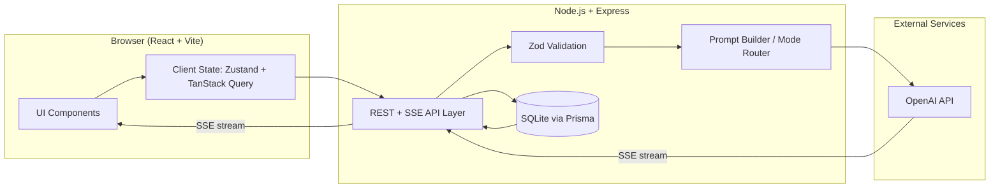
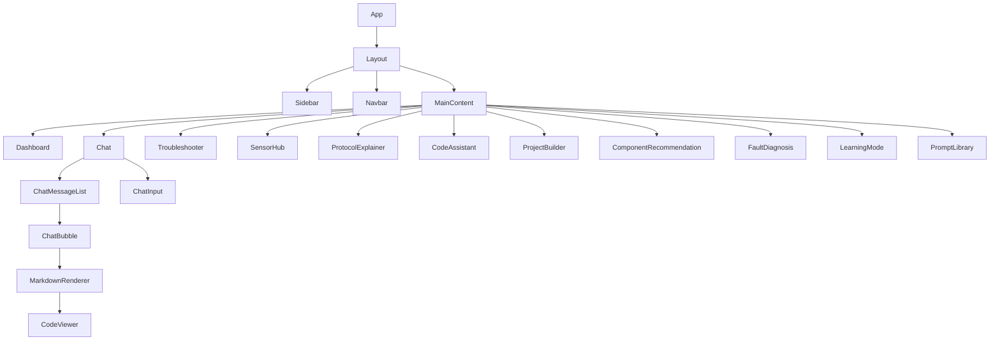
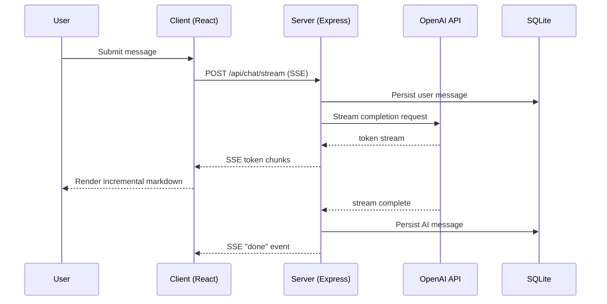
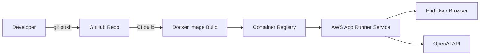

# SenseAI — Product Requirements Document

**Tagline:** Your AI Copilot for Industrial IoT Learning, Development & Troubleshooting
**Document Owner:** Product/Engineering
**Version:** 1.0
**Status:** Implementation-Ready

---

## Table of Contents

1. Executive Summary
2. Product Vision & Goals
3. Target Users & Personas
4. Core Product Philosophy
5. Design Philosophy
6. Feature Specifications (1–10)
7. Global Search
8. Dashboard
9. Chat Experience
10. UX Details (States, Motion, Micro-interactions)
11. Design System
12. Responsive Design
13. Component Inventory
14. AI Prompt Engineering (System Prompts)
15. Tech Stack
16. Security
17. Architecture (with Mermaid diagrams)
18. API Design
19. Performance
20. Testing Strategy
21. Development Roadmap
22. Future Roadmap (40+ Features)
23. Assumptions, Risks & Constraints
24. Non-Functional Requirements

---

## 1. Executive Summary

SenseAI is a web-based AI copilot purpose-built for the Industrial IoT (IIoT) domain. It replaces generic chatbot interactions with structured, engineering-grade workflows: sensor lookup, protocol explanation, code generation, project scaffolding, component recommendation, and fault diagnosis — all backed by a specialized system-prompt architecture layered over an LLM (OpenAI API).

The product targets engineering students and early-career IoT/automation engineers who currently stitch together datasheets, forum threads, and general-purpose chatbots to solve IIoT problems. SenseAI consolidates this into one dark-mode-first, keyboard-driven, Linear/Notion/Raycast-inspired interface.

This PRD is implementation-ready: every feature includes UX flow, component list, states, edge cases, acceptance criteria, and API contract, so an AI coding agent (Claude Code, Cursor, Windsurf, etc.) can scaffold and build the application with minimal ambiguity.

---

## 2. Product Vision & Goals

### Vision
Give every IoT learner and builder a senior engineer "on call" — available 24/7, structured around real engineering workflows rather than open-ended chat.

### Product Goals
| Goal | Metric |
|---|---|
| Reduce time-to-understanding for IIoT concepts | Median session → "concept understood" self-report |
| Reduce debugging time for sensor/hardware issues | Troubleshooter sessions resulting in resolution |
| Increase project completion rate for learners | Project Builder → completed roadmap milestones |
| Establish daily/weekly engagement habit | Learning streak retention (7-day, 30-day) |

### Success Criteria (v1 Launch)
- All 10 primary features functional end-to-end with streaming AI responses.
- Sub-200ms perceived UI latency (excluding model generation time).
- WCAG 2.1 AA compliant.
- Fully responsive from 320px to 4K.

---

## 3. Target Users & Personas

### Primary
- **IIoT Engineering Students** — coursework-driven, need concept clarity + working code.
- **Electronics / Embedded Systems Students** — hardware-first, need pin configs, voltage specs.
- **Arduino Beginners / ESP32 & Raspberry Pi Developers** — hobby-to-serious progression, need guided learning.

### Secondary
- **Automation / PLC / Industrial Maintenance Engineers** — need protocol depth (Modbus, OPC-UA) and fault diagnosis.
- **IoT Startups** — need component recommendation and architecture scaffolding for MVPs.
- **Hobbyists** — need approachable explanations and sample code.

### Representative Persona
**"Aarav", 3rd-year IIoT student.** Building a smart irrigation system for a college project. Knows Arduino basics, unfamiliar with LoRa vs Zigbee tradeoffs, struggling with a DHT22 giving NaN readings. Needs: protocol comparison, troubleshooting flow, and a project roadmap with a ₹3,000 budget constraint.

---

## 4. Core Product Philosophy

- SenseAI is **not** a general chatbot. Every surface nudges the user toward a structured workflow (pick a mode → fill structured inputs → get a structured, actionable output).
- Free-form chat exists (Feature 1) but is scoped strictly to engineering domains; the system prompt actively declines off-topic requests and redirects to the right mode when possible.
- Every AI answer is **practical, visual, and implementation-focused** — code blocks, tables, diagrams, and checklists are preferred over prose paragraphs.
- The product should feel like a **tool**, not a companion: no anthropomorphized avatar, no "typing personality," minimal chit-chat framing.

---

## 5. Design Philosophy

**Inspirations:** Linear (speed, keyboard-first), Notion (structured content blocks), Perplexity (cited, structured AI answers), Raycast (command palette, dark UI), Apple HIG (clarity, restraint), Tesla Service Dashboard / Modern Industrial HMI (data density done cleanly).

**Principles:**
- Dark mode is the default and primary designed experience; light mode is a full first-class parity theme, not an afterthought.
- No decorative gradients, no cartoon illustrations, no skeuomorphism.
- Typography-led hierarchy over color-led hierarchy.
- High information density is acceptable **only** when paired with strong grouping, whitespace rhythm, and progressive disclosure (accordions, drawers).
- Every interactive element has a visible focus state and a keyboard shortcut where feasible (command palette, `⌘K`).

---

## 6. Feature Specifications

Each feature below follows the mandated structure: Purpose, User Story, UX Flow, UI Components, States, Edge Cases, Acceptance Criteria, API Requirements, Future Improvements.

---

### Feature 1 — AI Engineering Chat

**Purpose:** General-purpose, domain-restricted conversational assistant for IIoT, embedded systems, automation, electronics, sensors, microcontrollers, networking, industrial communication, and cloud IoT.

**User Story:** As an engineering student, I want to ask open-ended technical questions and get accurate, structured, streaming answers so I can learn and debug without leaving the app.

**UX Flow:**
1. User lands on Chat (default landing tab or `⌘K` → "New Chat").
2. Empty state shows suggested prompts (from Prompt Library) and mode selector chips (General / Troubleshoot / Learn / Code).
3. User types message, presses Enter (Shift+Enter for newline).
4. Message streams token-by-token with a blinking cursor indicator.
5. Response renders Markdown live (headings, code blocks with syntax highlighting, tables, LaTeX via KaTeX).
6. User can Copy, Download (.md), Regenerate, or "Continue" a truncated response.
7. Conversation auto-saves to sidebar history with an AI-generated title after the first exchange.

**UI Components:** Chat input (auto-resizing textarea, attach button disabled/future), message bubble (user vs. AI variants), streaming cursor, code block viewer with copy button + language badge, markdown renderer, action toolbar (copy/regenerate/download/continue), sidebar chat list, mode chip selector, scroll-to-bottom FAB.

**States:** empty, typing (user), streaming (AI), complete, error (API failure — inline retry banner), rate-limited, offline (queued-send banner), regenerating (previous response dimmed).

**Edge Cases:**
- Extremely long user input (>4000 tokens) → client-side warning + truncation option.
- Network drop mid-stream → partial response preserved, "Response interrupted — Retry" affordance.
- Off-domain question (e.g., "write me a poem") → AI politely redirects per system prompt rules, does not hard-refuse rudely.
- Rapid successive sends → input disabled until stream completes or is cancelled (Stop button).

**Acceptance Criteria:**
- [ ] Responses stream via SSE with <500ms time-to-first-token under normal load.
- [ ] Markdown, code syntax highlighting, and tables render correctly for all supported languages.
- [ ] User can stop generation mid-stream.
- [ ] Chat history persists in SQLite and reloads on session resume.
- [ ] Off-topic queries receive a redirect response, not a hallucinated off-domain answer.

**API Requirements:** `POST /api/chat/stream` (SSE), `GET /api/chats`, `GET /api/chats/:id`, `DELETE /api/chats/:id`, `PATCH /api/chats/:id` (rename/pin).

**Future Improvements:** citations, file/image attachment, multi-turn tool calling (e.g., live sensor datasheet lookup), voice input.

---

### Feature 2 — Smart Troubleshooter

**Purpose:** Structured fault-diagnosis workflow for hardware/system issues, replacing trial-and-error forum searching.

**User Story:** As a maker, I want to describe symptoms and error codes and get ranked likely causes with safety-aware fixes, so I can resolve issues quickly and safely.

**UX Flow:**
1. User opens Troubleshooter (structured form, not free chat).
2. Fields: Symptom description (required), Error codes (optional, tag input), Sensor/actuator values (optional, key-value rows), Machine behavior (dropdown: intermittent / constant / on startup / under load), Logs (optional textarea), Image upload (disabled, marked "Coming soon").
3. Submit → AI streams a structured diagnosis card.
4. Output: Ranked list of possible causes with confidence %, recommended fixes (ordered by ease), safety warnings (highlighted red/amber), a testing checklist (checkable items), prevention tips.
5. User can mark checklist items done (local state) and export diagnosis as Markdown/PDF (future).

**UI Components:** Structured multi-field form, tag input, dynamic key-value row editor, dropdown, diagnosis result card, likelihood badge/progress bar, safety-warning banner (red/amber semantic), interactive checklist, export button.

**States:** empty form, validating, submitting, streaming diagnosis, complete, error, "no likely cause found — refine input" empty-result state.

**Edge Cases:**
- Vague symptom text ("it doesn't work") → AI asks 1–2 clarifying follow-up questions before diagnosing rather than guessing.
- Conflicting sensor values (e.g., negative voltage where impossible) → AI flags data inconsistency.
- Safety-critical symptoms (smoke, burning smell, high voltage exposure) → safety warning always rendered first, above ranked causes.

**Acceptance Criteria:**
- [ ] Form validates required fields before submit.
- [ ] AI output always includes causes ranked by likelihood, fixes, and a testing checklist.
- [ ] Safety warnings render with distinct visual treatment and cannot be visually missed (top-of-card placement).
- [ ] Checklist state persists per diagnosis within a session.

**API Requirements:** `POST /api/troubleshoot` (SSE), request body includes structured fields above; response is structured JSON-over-stream (cause[], fixes[], safety[], checklist[], prevention[]).

**Future Improvements:** image-based fault detection (CV), log-file upload & parsing, historical diagnosis tracking per device.

---

### Feature 3 — Sensor Knowledge Hub

**Purpose:** Searchable reference + AI-explainer for common sensors (MQ-135, DHT22, BMP280, Ultrasonic, IR, PIR, gas, current, voltage, pressure, etc.).

**User Story:** As a student, I want to search a sensor and get a complete, structured technical breakdown so I don't need to parse a raw datasheet PDF.

**UX Flow:**
1. User searches or browses sensor grid (card per sensor, categorized: Environmental / Motion / Gas / Electrical / Pressure / Proximity).
2. Selecting a sensor opens a detail view (drawer on desktop, full-screen on mobile) with tabbed sections: Overview, Pinout, Specs, Code, Calibration, Industrial Use.
3. AI generates/streams content per tab on first open, then caches locally for the session.
4. "Ask about this sensor" quick-action pre-fills Chat with sensor context.

**UI Components:** Sensor card grid, category filter chips, search bar (feeds Global Search), detail drawer with tabs, pinout diagram (SVG, generated/templated), spec table, sample-code viewer, calibration step list, "common mistakes" callout list.

**States:** browsing grid, loading detail (skeleton per tab), loaded, tab-switch loading (per-tab, cached after first load), search-no-results (with "Ask AI about [query]" fallback CTA).

**Edge Cases:**
- Sensor not in curated list → search falls back to AI-generated response with a "community-generated, not verified" badge.
- Sensor with multiple variants (e.g., DHT11 vs DHT22) → disambiguation chips shown before detail load.

**Acceptance Criteria:**
- [ ] At least 30 sensors pre-seeded with curated metadata (name, category, image placeholder, aliases) for search/filter to work offline of AI generation.
- [ ] Each detail tab (Working principle, pin config, voltage, applications, advantages, limitations, common mistakes, datasheet summary, calibration, sample code, industrial use) renders distinctly.
- [ ] Sample code is language-selectable (Arduino/ESP32/Python) where applicable.

**API Requirements:** `GET /api/sensors` (list, filterable), `GET /api/sensors/:slug` (curated metadata), `POST /api/sensors/:slug/explain` (SSE, AI content per tab, cached server-side per slug+tab).

**Future Improvements:** real datasheet PDF ingestion & summarization, community-submitted calibration notes, wiring-diagram generator.

---

### Feature 4 — Protocol Explainer

**Purpose:** Deep explanations and side-by-side comparisons of IoT/industrial communication protocols (MQTT, HTTP, CoAP, LoRa, Zigbee, BLE, Wi-Fi, CAN, Modbus, OPC-UA).

**User Story:** As a developer choosing a comm protocol, I want a clear comparison with architecture diagrams so I can make an informed decision for my project's constraints (range, power, cost, data rate).

**UX Flow:**
1. Protocol grid (card per protocol) with quick filter (Wireless / Wired / Industrial / Web).
2. Select 1 protocol → detail view (architecture diagram via Mermaid, advantages/disadvantages tables, real-world examples).
3. Select 2+ protocols (checkbox mode) → "Compare" view generates a side-by-side comparison table (range, power, cost, latency, topology, use cases).

**UI Components:** Protocol card grid, compare-mode checkbox toggle, comparison table (sticky first column), Mermaid diagram renderer, pros/cons two-column layout, real-world example callouts.

**States:** browsing, single detail loaded, compare-mode selecting (0–4 selectable), compare loading, compare loaded, max-selection-reached (disable further checkboxes at 4).

**Edge Cases:**
- Comparing protocols from very different layers (e.g., MQTT vs LoRa — application vs physical layer) → AI explicitly notes the layer mismatch and reframes comparison usefully (e.g., "often used together").
- Single-protocol edge case where user selects only 1 for compare → button disabled with tooltip "Select at least 2 to compare."

**Acceptance Criteria:**
- [ ] All 10 listed protocols pre-seeded with curated summaries + Mermaid architecture diagrams.
- [ ] Compare mode supports 2–4 protocols simultaneously.
- [ ] Diagrams render via Mermaid.js without layout overflow on mobile (horizontal scroll container fallback).

**API Requirements:** `GET /api/protocols`, `GET /api/protocols/:slug`, `POST /api/protocols/compare` (body: slug[], SSE response).

**Future Improvements:** interactive protocol-selector wizard ("answer 4 questions → recommended protocol"), latency/range simulators.

---

### Feature 5 — Code Assistant

**Purpose:** Generate and explain working code for Arduino, ESP32, Raspberry Pi, Python, NodeMCU, and PlatformIO targets.

**User Story:** As a beginner, I want to describe what I want my microcontroller to do and receive working, explained code so I can learn by example.

**UX Flow:**
1. User selects target platform (chip/board selector) and language (auto-defaulted per platform, e.g., ESP32 → C++/Arduino or MicroPython toggle).
2. User describes desired behavior in a prompt box (structured hints: "what sensors/pins are involved?" optional fields).
3. AI streams code in a code viewer with inline "explain this line" hover affordance and a separate "Explanation" panel below summarizing key sections.
4. User can copy, download as file (correct extension per platform), or send to Project Builder as a starting point.

**UI Components:** Platform/board selector (icon grid), language toggle, prompt textarea, code viewer (line numbers, syntax highlighting, copy/download buttons), explanation panel (collapsible per section), "highlighted important lines" gutter markers.

**States:** platform-not-selected (CTA disabled), generating, streamed-complete, explanation-loading (secondary stream after code completes), error (invalid platform/language combo).

**Edge Cases:**
- User requests code requiring a library not commonly available → AI notes the dependency and installation step explicitly.
- Platform/language mismatch (e.g., Python selected for Arduino Uno) → UI prevents combination via disabled options.

**Acceptance Criteria:**
- [ ] Supports code generation for Arduino, ESP32, Raspberry Pi (Python), NodeMCU, PlatformIO project structure.
- [ ] Explanation panel highlights at least the setup/init, main loop, and I/O handling sections distinctly.
- [ ] Download produces a correctly-extensioned file (.ino, .py, platformio.ini + src/main.cpp bundle as .zip for PlatformIO).

**API Requirements:** `POST /api/code/generate` (SSE), `POST /api/code/explain` (SSE, follow-up on generated code id).

**Future Improvements:** in-browser compile/simulate (Wokwi integration), GitHub export, PlatformIO project scaffolding download.

---

### Feature 6 — Project Builder

**Purpose:** Turn an idea + constraints into a structured project plan: architecture, components, connection flow, roadmap, cost estimate, challenges, future improvements.

**User Story:** As a student with a project idea and a budget, I want an AI-generated plan and shopping list so I can start building with confidence.

**UX Flow:**
1. Structured intake form: Idea (textarea), Requirements (tag input), Budget (currency input, ₹ default with selector), Sensors available (multi-select from Sensor Hub), Microcontroller (select or "recommend one for me").
2. Submit → AI streams a multi-section project plan.
3. Output sections rendered as cards/accordion: System Architecture (Mermaid diagram), Component List (table with est. price), Connection Flow (step list), Development Roadmap (timeline component), Estimated Total Cost, Challenges & Mitigations, Future Improvements.
4. "Save Project" persists to user's Projects list (dashboard "Continue conversation"/pinned equivalent for projects).

**UI Components:** Multi-step intake form (or single-page structured form), currency input, multi-select chips, Mermaid diagram, cost table, timeline/roadmap component (phase-based), challenge callouts, Save/Export buttons.

**States:** intake-incomplete, generating (staged: "Designing architecture…" → "Selecting components…" progress labels), complete, saved, editing-saved-project.

**Edge Cases:**
- Budget too low for stated requirements → AI flags the gap explicitly and proposes a scoped-down alternative.
- User has zero sensors selected → AI recommends a starter set based on idea description.

**Acceptance Criteria:**
- [ ] Output always includes all 7 sections (architecture, components, connections, roadmap, cost, challenges, future improvements).
- [ ] Cost estimates are itemized per component, with a summed total.
- [ ] Saved projects appear on Dashboard and are individually re-openable/editable.

**API Requirements:** `POST /api/projects/generate` (SSE), `GET /api/projects`, `POST /api/projects`, `PATCH /api/projects/:id`, `DELETE /api/projects/:id`.

**Future Improvements:** shareable public project links, BOM export to CSV, real-time component price lookup via distributor APIs.

---

### Feature 7 — Component Recommendation

**Purpose:** Recommend sensors, microcontrollers, communication modules, power supplies, displays, and actuators based on stated requirements.

**User Story:** As a builder, I want ranked component recommendations matching my constraints (budget, power, environment) so I don't over- or under-spec my build.

**UX Flow:**
1. Structured requirement form: Use case category, environment (indoor/outdoor/industrial), power constraint (battery/mains), budget, precision needs.
2. AI returns ranked recommendation cards per component category requested, each with rationale, tradeoffs vs. alternatives, and estimated price band.
3. User can add recommended components directly into a Project Builder session.

**UI Components:** Requirement form, recommendation card (component image placeholder, name, rationale, price band, "why not X instead" expandable), "Add to Project" action.

**States:** empty, generating, loaded, empty-result (no strong match — AI explains why and suggests relaxing constraints).

**Edge Cases:**
- Contradictory requirements (e.g., "lowest cost" + "industrial-grade precision") → AI surfaces the tradeoff explicitly rather than silently picking one.

**Acceptance Criteria:**
- [ ] Each recommendation includes at least one alternative comparison ("why this over X").
- [ ] Recommendations are categorized (sensor/microcontroller/comm/power/display/actuator) even when multiple categories are requested at once.

**API Requirements:** `POST /api/components/recommend` (SSE).

**Future Improvements:** live distributor price/stock integration, compatibility checker (voltage/interface matching across selected components).

---

### Feature 8 — Industrial Fault Diagnosis

**Purpose:** Analyze industrial sensor readings (temperature, pressure, current, voltage, RPM, humidity, vibration) to produce a health score, fault probability, maintenance suggestion, and priority level.

**User Story:** As a maintenance engineer, I want to input recent readings and get a quick health assessment so I can prioritize maintenance actions.

**UX Flow:**
1. Structured input: parameter rows (name, value, unit, normal range optional), equipment type (dropdown: motor/pump/compressor/generic).
2. Submit → AI computes/streams: Health Score (0–100, gauge visual), Fault Probability (%, per potential fault type), Suggested Maintenance actions, Priority Level (Low/Medium/High/Critical, color-coded).

**UI Components:** Dynamic parameter row editor, equipment-type selector, health-score gauge (radial), fault-probability bar list, priority badge, maintenance action list.

**States:** empty, submitting, streaming, complete, critical-priority (distinct visual treatment — red banner + top placement).

**Edge Cases:**
- Reading clearly out of physically plausible range → flagged as likely sensor fault rather than equipment fault.
- Insufficient parameters for equipment type (e.g., motor with no RPM given) → AI notes reduced confidence explicitly.

**Acceptance Criteria:**
- [ ] Health score always accompanied by a stated confidence/rationale, not a bare number.
- [ ] Critical priority results are visually unmissable (top-of-page banner + non-dismissible until acknowledged).

**API Requirements:** `POST /api/fault-diagnosis` (SSE).

**Future Improvements:** time-series trend input (upload CSV of historical readings), predictive maintenance scheduling, integration with real SCADA/OPC-UA data feeds.

---

### Feature 9 — Learning Mode

**Purpose:** Step-by-step structured teaching of IIoT concepts across Beginner/Intermediate/Advanced difficulty, with examples, analogies, mini quizzes, and practice tasks.

**User Story:** As a beginner, I want a guided lesson on a topic (e.g., "MQTT basics") broken into digestible steps with checks for understanding, so I actually retain the material.

**UX Flow:**
1. User picks a topic (from catalog or free text) and difficulty level.
2. AI generates a lesson broken into numbered steps/sections, each renderable as a card the user progresses through (Next/Back navigation, progress bar).
3. Periodic mini-quiz cards (multiple choice or short answer) interspersed; immediate feedback shown.
4. End-of-lesson practice task (mini project or exercise prompt).
5. Completion updates the user's Learning Streak on Dashboard.

**UI Components:** Topic catalog grid, difficulty selector, lesson-step card with progress bar, quiz card (MCQ/short-answer variants), feedback state (correct/incorrect with explanation), practice-task card, streak indicator.

**States:** topic-selection, lesson-loading, in-lesson (step N of M), quiz-active, quiz-answered, lesson-complete.

**Edge Cases:**
- User exits mid-lesson → progress saved, resumable from Dashboard "Continue" or Learning Mode "Resume" card.
- Wrong quiz answer → AI gives a targeted explanation, not just "incorrect," and allows retry.

**Acceptance Criteria:**
- [ ] Every lesson includes at least one analogy, one worked example, one quiz, and one practice task.
- [ ] Lesson progress persists per user per topic.
- [ ] Streak increments once per calendar day of any completed lesson/quiz activity, not per action.

**API Requirements:** `POST /api/learning/lessons` (generate, SSE), `GET /api/learning/progress`, `PATCH /api/learning/progress/:topicId`.

**Future Improvements:** adaptive difficulty based on quiz performance, spaced-repetition review scheduling, certificates/badges.

---

### Feature 10 — Prompt Library

**Purpose:** Curated, categorized, searchable collection of ready-made engineering prompts to reduce blank-page friction and teach effective prompting.

**User Story:** As a new user, I want example prompts I can use or adapt so I know what SenseAI is capable of.

**UX Flow:**
1. Grid/list of prompt cards grouped by category (Troubleshooting, Sensors, Protocols, Code, Project Ideas, Learning).
2. Search/filter bar (feeds Global Search too).
3. Click a prompt card → pre-fills Chat (or the relevant structured feature) with that prompt/context and navigates there.
4. Favorite (star) toggles a prompt into a "Favorites" filter view, persisted per user.

**UI Components:** Prompt card (category tag, title, preview text, favorite star), category filter chips, search bar, favorites toggle view.

**States:** browsing, filtered, search-no-results, favorited, unfavorited.

**Edge Cases:**
- Prompt intended for a structured feature (e.g., Troubleshooter) clicked while user is elsewhere → navigates to correct feature route with fields pre-filled, not just Chat.

**Acceptance Criteria:**
- [ ] At least 50 curated prompts pre-seeded across all categories at launch.
- [ ] Favoriting persists across sessions.
- [ ] Search matches on title, preview text, and category.

**API Requirements:** `GET /api/prompts`, `POST /api/prompts/:id/favorite`, `DELETE /api/prompts/:id/favorite`.

**Future Improvements:** user-submitted community prompts (moderated), prompt versioning/remixing, trending prompts.

---

## 7. Global Search

Universal, keyboard-accessible (`⌘K` / `Ctrl+K`) command-palette style search spanning: Sensors, Protocols, Projects, Components, Previous Chats, Learning Modules, Prompt Library.

**Behavior:**
- Opens as a centered modal overlay with a single input, debounced (250ms) fuzzy search.
- Results grouped by category with section headers, max 5 per category shown inline + "See all N results" per category.
- Keyboard navigable (↑/↓ to move, Enter to select, Esc to close).
- Recent searches shown when input is empty.

**States:** closed, empty (recent searches shown), typing/debouncing, results-loaded, no-results (with "Ask AI: [query]" fallback that opens Chat pre-filled).

**Acceptance Criteria:**
- [ ] Search returns results within 300ms for local/curated data (sensors, protocols, prompts) and separately streams AI-fallback suggestions if no direct match.
- [ ] Fully keyboard operable without mouse.

**API Requirements:** `GET /api/search?q=&types=` (parallel queries across curated tables; chats/projects/learning scoped to authenticated user).

---

## 8. Dashboard

The Dashboard is the default post-login landing screen.

**Sections:**
- **Quick Actions** — icon buttons/cards for each of the 10 primary features, always visible at top.
- **Continue Conversation** — last active chat with a resume affordance.
- **Recent Activity** — chronological feed (chats, troubleshooting sessions, projects, lessons) up to last 10 items.
- **Pinned Chats** — user-pinned conversations, max shown 5 with "View all."
- **Trending Engineering Topics** — curated/editorial list (updatable via config, not user-generated at v1).
- **Popular Sensors** — top N sensors by Sensor Hub view count (or curated fallback pre-launch).
- **Learning Streak** — current streak count, calendar heat-strip (last 14 days), CTA to continue Learning Mode.

**States:** first-time-empty (all sections show onboarding CTAs instead of data), loaded, partial-data (some sections empty individually, e.g., no pinned chats yet → "Pin a chat to see it here").

**Acceptance Criteria:**
- [ ] Dashboard loads all sections independently (skeleton per section) — one slow section must not block others from rendering.
- [ ] Quick Actions always visible without scrolling on desktop ≥1280px width.

**API Requirements:** `GET /api/dashboard` (aggregated payload: recentActivity[], pinnedChats[], streak, popularSensors[], trendingTopics[]).

---

## 9. Chat Experience

Detailed requirements beyond Feature 1's spec:

- **Streaming:** Server-Sent Events (SSE); client renders incrementally via a token buffer flushed on animation frame for smooth rendering without layout thrash.
- **Markdown:** full CommonMark + tables (GFM) + fenced code blocks.
- **Syntax highlighting:** via Shiki or Prism, supporting C/C++ (Arduino), Python, JSON, YAML, Bash.
- **Math:** KaTeX rendering for inline (`$...$`) and block (`$$...$$`) equations (relevant for sensor calibration formulas, signal processing).
- **Tables:** rendered as styled HTML tables with horizontal scroll on overflow (mobile).
- **Actions per message:** Copy (raw markdown or rendered text toggle), Download (.md), Regenerate (re-run with same prompt, previous response collapses into a "previous version" toggle), Continue (for responses that hit token limits, mid-generation continuation).
- **Citations:** marked as future — UI should reserve a small "Sources" affordance slot in the message footer for forward compatibility, but v1 ships without live citations.

---

## 10. UX Details — States, Motion, Micro-interactions

**Global interaction principles:**
- All transitions 150–250ms, `ease-out` for entrances, `ease-in` for exits. No transition exceeds 300ms (feels sluggish in a "tool").
- Hover states on all clickable elements: subtle background shift (+4% lightness in dark mode) — no scale/bounce effects (avoid "playful app" feel).
- Buttons: pressed state = 96% scale + slight opacity dip, 100ms.

**Loading states:**
- Skeletons (not spinners) for content-shaped loads (cards, lists, tables) — shimmer animation, 1.5s loop.
- Spinners reserved only for indeterminate, non-content actions (e.g., "Saving…" inline next to a button).
- Streaming cursor: a blinking 2px vertical bar at the end of AI-generated text, 530ms blink interval, removed on stream completion.
- Typing indicator (three-dot pulse) shown only during the gap between "message sent" and "first token received."

**Success/Error/Empty/Offline:**
- Success: inline toast, top-right, auto-dismiss 3s, green accent (color, not just icon, for accessibility redundancy — always paired with a checkmark icon + text).
- Error: inline contextual banner near the point of failure (not just a toast) with a Retry action; toast reserved for non-blocking background errors only.
- Empty states: always include an icon/illustration (simple line-icon, not cartoon), one-line explanation, and a primary CTA.
- Offline: persistent top banner ("You're offline — messages will send when reconnected"), outgoing chat messages queue locally and show a "pending" clock icon until reconnect.

---

## 11. Design System

### Typography Scale
| Token | Size / Line-height | Usage |
|---|---|---|
| `display` | 36px/44px, 600 | Page-level hero (rare) |
| `h1` | 28px/36px, 600 | Page titles |
| `h2` | 22px/30px, 600 | Section headers |
| `h3` | 18px/26px, 600 | Card/subsection headers |
| `body-lg` | 16px/24px, 400 | Primary reading text, chat messages |
| `body` | 14px/20px, 400 | Default UI text |
| `body-sm` | 13px/18px, 400 | Secondary/meta text |
| `caption` | 12px/16px, 500 | Labels, badges, timestamps |
| `mono` | 13.5px/20px, 400 | Code, technical values |

Font family: Inter (UI text), JetBrains Mono (code/technical values).

### Color Tokens (Dark mode primary)
| Token | Value (approx) | Usage |
|---|---|---|
| `bg-canvas` | #0A0B0D | App background |
| `bg-surface` | #131417 | Cards, panels |
| `bg-surface-raised` | #1B1D21 | Modals, dropdowns |
| `border-subtle` | #2A2D33 | Default borders |
| `text-primary` | #F2F3F5 | Primary text |
| `text-secondary` | #9CA0A8 | Secondary text |
| `text-tertiary` | #6B6F76 | Disabled/meta |
| `accent-primary` | #4C8DFF | Primary actions, links |
| `accent-primary-hover` | #6DA0FF | Hover state |
| `success` | #33C481 | Success states |
| `warning` | #E8A63C | Amber warnings |
| `danger` | #EF5A5A | Critical/error/safety |
| `info` | #6B8FE8 | Informational callouts |

Light mode uses the same token *names* with inverted/adjusted values (full parity spec to be maintained in `tokens.css`/Tailwind config — not enumerated line-by-line here to avoid redundancy, but every dark-mode token above requires a corresponding light-mode value at implementation time).

### Spacing & Grid
- Base unit: 4px. Scale: 4, 8, 12, 16, 24, 32, 48, 64, 96.
- Max content width: 1280px (dashboard/chat), 960px (reading-focused detail views).
- 12-column grid for dashboard/grid layouts, gutter 24px desktop / 16px tablet / 12px mobile.

### Radius & Elevation
- Radius scale: `sm` 6px (inputs, badges), `md` 10px (cards, buttons), `lg` 16px (modals, drawers).
- Elevation via subtle border + soft shadow (not heavy drop shadows): `shadow-sm` for cards, `shadow-lg` for modals/popovers, no elevation on flat page backgrounds.

### Icons & Illustration
- Icon set: Lucide (outline style, 1.5px stroke), 16/20/24px sizes.
- No custom mascot or character illustrations. Empty states use simple geometric line icons only.

### Motion System
- Standard easing curve: `cubic-bezier(0.16, 1, 0.3, 1)` for entrances.
- Framer Motion used for page/section transitions (fade + 8px translate-Y, 200ms).
- Reduced-motion: respect `prefers-reduced-motion` — disable translate, keep opacity-only fades.

### Accessibility
- WCAG 2.1 AA minimum contrast ratios enforced for all token pairs.
- All interactive elements keyboard-reachable with visible focus ring (2px, `accent-primary`, 2px offset).
- ARIA live regions for streaming chat content (`aria-live="polite"`) so screen readers announce completed segments, not every token.

---

## 12. Responsive Design

| Breakpoint | Range | Layout notes |
|---|---|---|
| Mobile | 320–767px | Single column, bottom nav for primary features, sidebar becomes a slide-over drawer, detail views full-screen (no side drawers) |
| Tablet | 768–1023px | Two-column where applicable (e.g., sensor grid 2-up), sidebar collapsible/icon-only |
| Laptop | 1024–1439px | Full sidebar + main content, 2–3 column grids |
| Desktop | 1440px+ | Max-width content containers (1280px) centered, extra whitespace, not extra content density |

**Touch interactions:** minimum 44×44px tap targets on touch devices; swipe-to-dismiss for drawers/toasts on mobile; long-press reserved for future context menus (not required v1).

**Landscape mobile:** chat input remains sticky at bottom; sidebar/history accessible via a top-bar menu icon rather than persistent column.

---

## 13. Component Inventory

Documented as: Component — Variants — Key states.

- **Button** — primary/secondary/ghost/danger, icon-only — default/hover/active/disabled/loading
- **Card** — default/interactive(clickable)/outlined — default/hover/selected
- **Sidebar** — expanded/collapsed(icon-only)/mobile-drawer — default/active-item-highlighted
- **Navbar** — top-level app bar with search trigger, user menu, theme toggle
- **Search (Global)** — command-palette modal — closed/open/typing/results/no-results
- **Prompt Card** — grid item — default/hover/favorited
- **Chat Bubble** — user/AI variants — sending/sent/streaming/error
- **Response Cards** — structured output containers (used in Troubleshooter, Fault Diagnosis, Project Builder) — loading/loaded/error
- **Sensor Cards** — grid item — default/hover
- **Protocol Cards** — grid item, with compare-checkbox variant — default/selected-for-compare
- **Project Cards** — dashboard/list item — default/generating/saved
- **Code Viewer** — syntax-highlighted block — default/copied(momentary)/loading
- **Tables** — data table, comparison table (sticky header/column variants)
- **Accordions** — single/multi-expand — collapsed/expanded
- **Timeline** — roadmap/phase display — default, with active-phase highlight
- **Charts** — gauge (health score), bar (fault probability), heat-strip (streak) — loading/loaded
- **Badges** — status (priority), category tag, count badge
- **Dialogs** — confirmation, form-in-modal — open/closed/loading(submitting)
- **Drawers** — detail panels (sensor/protocol detail on desktop) — closed/opening/open/closing
- **Toasts** — success/error/info — entering/visible/exiting
- **Tooltips** — hover-triggered, keyboard-focus-triggered
- **Progress Bars** — lesson progress, upload/generation progress — determinate/indeterminate
- **Loading Components** — skeleton (block/text/card variants), spinner (small inline only), streaming cursor

---

## 14. AI Prompt Engineering (System Prompts)

Each mode below is powered by a distinct, versioned system prompt. All system prompts share a **Base Directive** injected first, followed by mode-specific instructions.

### Base Directive (shared preamble, all modes)
```
You are SenseAI, a specialized engineering assistant for Industrial IoT,
embedded systems, automation, electronics, and related domains.

Role: Act as a senior IoT/embedded engineer mentor — precise, practical,
safety-conscious, and structured.

Domain scope: IIoT, embedded systems, sensors, microcontrollers,
networking/communication protocols, industrial automation, cloud IoT,
electronics fundamentals directly relevant to the above.

Out-of-scope handling: If a request is clearly unrelated to the domain
scope (e.g., creative writing, unrelated trivia, general life advice),
politely decline and redirect the user to an appropriate SenseAI feature
or ask how their question relates to an engineering task. Do not be
curt or robotic in the redirect.

Tone: Precise, direct, encouraging but not casual. No excessive
enthusiasm, no filler apologies, no emoji unless user uses them first.

Output structure: Prefer structured formats (headers, bullet lists,
tables, code blocks) over long prose paragraphs. Bold key terms on
first use. Use tables for comparisons. Use numbered lists for
sequential/procedural steps.

Hallucination prevention: Never fabricate specific numeric
specifications (voltage, current, pin numbers) you are not confident
about — state a typical/common range and explicitly flag it as
"typical value, verify against your specific module's datasheet" when
uncertain. Never invent library names, function signatures, or API
methods that may not exist — if uncertain, say so and suggest how the
user can verify (official docs, library reference).

Safety rules: Always surface safety warnings before recommendations
when a scenario involves mains voltage, high current, heat, pressure,
or gas. Never instruct a user to bypass a safety mechanism (fuses,
relays, pressure valves) without an explicit, prominent warning.

Engineering accuracy guidelines: Prefer widely-adopted, well-documented
components and practices over obscure ones unless the user's
constraints require otherwise. When multiple valid approaches exist,
present the tradeoff rather than asserting one "correct" answer.
```

### Mode-Specific Additions (summary — full text per mode should mirror this structure)
- **Chat (Feature 1):** "Maintain conversational context across turns. Ask a clarifying question only when the request is genuinely ambiguous; otherwise proceed with the most reasonable interpretation and state assumptions inline."
- **Troubleshooter (Feature 2):** "Always output in this order: Safety Warnings (if any) → Ranked Possible Causes (with confidence %) → Recommended Fixes → Testing Checklist → Prevention Tips. If input is too vague to rank causes meaningfully, ask up to 2 targeted clarifying questions before proceeding."
- **Sensor Hub (Feature 3):** "Output must cover, in order: Working Principle, Pin Configuration, Voltage Requirements, Applications, Advantages, Limitations, Common Mistakes, Datasheet Summary, Calibration Guide, Sample Code, Industrial Use Cases. Mark any values not sourced from a well-known standard datasheet as approximate."
- **Protocol Explainer (Feature 4):** "When comparing protocols, structure output as a table first, then prose elaboration. Explicitly note when compared protocols operate at different OSI layers or serve complementary (not competing) roles."
- **Code Assistant (Feature 5):** "Generate complete, compilable/runnable code, not fragments, unless the user explicitly asks for a snippet. Follow this with a structured explanation broken into: Setup/Initialization, Main Logic, I/O Handling, Notable Considerations. Note any required libraries and installation steps."
- **Project Builder (Feature 6):** "Always output all seven sections: Architecture, Components, Connection Flow, Roadmap, Estimated Cost, Challenges, Future Improvements — even if brief. Flag budget/requirement mismatches explicitly rather than silently ignoring constraints."
- **Component Recommendation (Feature 7):** "For each recommendation, include one comparative alternative and the rationale for preferring the recommendation. Surface constraint conflicts explicitly."
- **Fault Diagnosis (Feature 8):** "Output a Health Score (0-100) with stated rationale, per-fault-type probability, prioritized maintenance actions, and an overall Priority Level. Flag physically implausible readings as probable sensor faults."
- **Learning Mode (Feature 9):** "Structure lessons as sequential steps appropriate to the stated difficulty level. Include at least one analogy, one worked example, one comprehension check (quiz), and one practice task per lesson. Adjust vocabulary complexity to difficulty level explicitly."
- **Prompt Library:** No live generation — static curated content, versioned in the database/seed data, not AI-generated at request time.

---

## 15. Tech Stack

**Frontend:** React 18, TypeScript, Vite, Tailwind CSS, Framer Motion, Zustand or React Context for client state, TanStack Query for server-state/caching, KaTeX (math), Shiki/Prism (syntax highlighting), Mermaid.js (diagrams).

**Backend:** Node.js (LTS), Express, OpenAI API (streaming via SSE), Zod for request validation.

**Database:** SQLite (local-first), accessed via Prisma or better-sqlite3 (Prisma recommended for migration management and type safety).

**Deployment:** Docker (multi-stage build: build frontend → serve via Express static + API), AWS App Runner.

**Rationale notes:** SQLite chosen for local-first simplicity and zero-ops at this stage; schema should be designed to allow a straightforward future migration to PostgreSQL (avoid SQLite-only features like `ROWID` reliance beyond defaults).

---

## 16. Security

- **Environment variables:** all secrets (OpenAI API key, session secret) via `.env`, never committed; `.env.example` provided.
- **Rate limiting:** per-IP and per-authenticated-user limits on AI-generation endpoints (e.g., `express-rate-limit`, sliding window, ~20 requests/min/user on streaming endpoints).
- **Input validation:** all request bodies validated via Zod schemas server-side before reaching AI prompt construction; reject oversized payloads (>8KB for structured form fields).
- **Prompt sanitization:** strip/escape user input patterns attempting system-prompt override ("ignore previous instructions" style injection) before interpolating into prompts; log flagged attempts server-side for review.
- **CORS:** restrict to known frontend origin(s) in production; permissive only in local dev.
- **Helmet:** standard secure headers middleware enabled (CSP, X-Frame-Options, etc.).
- **Secure headers:** enforce HTTPS in production (redirect HTTP→HTTPS at the App Runner/load-balancer level), `Strict-Transport-Security` header set.

---

## 17. Architecture

### System Architecture (high-level)



### Component Hierarchy (Frontend, simplified)



### Folder Structure

```
senseai/
├── apps/
│   ├── client/                 # React + Vite frontend
│   │   ├── src/
│   │   │   ├── components/     # shared UI components
│   │   │   ├── features/       # one folder per feature (chat, troubleshooter, ...)
│   │   │   ├── layouts/
│   │   │   ├── hooks/
│   │   │   ├── lib/            # api client, utils
│   │   │   ├── stores/         # zustand stores
│   │   │   ├── styles/         # tailwind config, tokens
│   │   │   └── main.tsx
│   │   └── vite.config.ts
│   └── server/                  # Express backend
│       ├── src/
│       │   ├── routes/          # one file per feature domain
│       │   ├── services/        # prompt builders, OpenAI client wrapper
│       │   ├── middleware/      # auth, rateLimit, validation, errorHandler
│       │   ├── prisma/          # schema.prisma, migrations
│       │   └── index.ts
│       └── package.json
├── packages/
│   └── shared-types/            # shared TS types between client/server
├── docker/
│   ├── Dockerfile
│   └── docker-compose.yml
└── README.md
```

### Data Flow (streaming chat, sequence)



### Deployment Architecture



---

## 18. API Design

All AI-generation endpoints use SSE (`Content-Type: text/event-stream`) and share a common event schema: `event: token` (data: string chunk), `event: done` (data: {messageId}), `event: error` (data: {message, code}).

### Chat
| Endpoint | Method | Request | Response |
|---|---|---|---|
| `/api/chats` | GET | — | `Chat[]` (list, paginated) |
| `/api/chats/:id` | GET | — | `Chat` with `Message[]` |
| `/api/chat/stream` | POST | `{chatId?, message}` | SSE token stream, ends with `done: {chatId, messageId}` |
| `/api/chats/:id` | PATCH | `{title?, pinned?}` | `Chat` |
| `/api/chats/:id` | DELETE | — | `204` |

### Troubleshooter
| Endpoint | Method | Request | Response |
|---|---|---|---|
| `/api/troubleshoot` | POST | `{symptoms, errorCodes[], sensorValues[], behavior, logs?}` | SSE structured stream |

### Sensors
| Endpoint | Method | Request | Response |
|---|---|---|---|
| `/api/sensors` | GET | `?category=&q=` | `Sensor[]` |
| `/api/sensors/:slug` | GET | — | `SensorDetail` (curated metadata) |
| `/api/sensors/:slug/explain` | POST | `{tab}` | SSE content for tab, cached |

### Protocols
| Endpoint | Method | Request | Response |
|---|---|---|---|
| `/api/protocols` | GET | `?type=` | `Protocol[]` |
| `/api/protocols/:slug` | GET | — | `ProtocolDetail` |
| `/api/protocols/compare` | POST | `{slugs: string[]}` | SSE comparison |

### Code Assistant
| Endpoint | Method | Request | Response |
|---|---|---|---|
| `/api/code/generate` | POST | `{platform, language, prompt}` | SSE code stream |
| `/api/code/explain` | POST | `{codeId}` | SSE explanation stream |

### Project Builder
| Endpoint | Method | Request | Response |
|---|---|---|---|
| `/api/projects/generate` | POST | `{idea, requirements[], budget, sensors[], microcontroller?}` | SSE structured plan |
| `/api/projects` | GET/POST | — / `{...plan}` | `Project[]` / `Project` |
| `/api/projects/:id` | PATCH/DELETE | `{...}` / — | `Project` / `204` |

### Component Recommendation
| Endpoint | Method | Request | Response |
|---|---|---|---|
| `/api/components/recommend` | POST | `{categories[], useCase, environment, budget, precision}` | SSE recommendation list |

### Fault Diagnosis
| Endpoint | Method | Request | Response |
|---|---|---|---|
| `/api/fault-diagnosis` | POST | `{equipmentType, parameters[]}` | SSE structured result |

### Learning Mode
| Endpoint | Method | Request | Response |
|---|---|---|---|
| `/api/learning/lessons` | POST | `{topic, difficulty}` | SSE lesson stream |
| `/api/learning/progress` | GET | — | `Progress[]` |
| `/api/learning/progress/:topicId` | PATCH | `{step, completed}` | `Progress` |

### Prompt Library
| Endpoint | Method | Request | Response |
|---|---|---|---|
| `/api/prompts` | GET | `?category=&q=` | `Prompt[]` |
| `/api/prompts/:id/favorite` | POST/DELETE | — | `204` |

### Search & Dashboard
| Endpoint | Method | Request | Response |
|---|---|---|---|
| `/api/search` | GET | `?q=&types=` | `SearchResults` (grouped) |
| `/api/dashboard` | GET | — | Aggregated dashboard payload |

**Error handling convention:** all non-stream errors return `{error: {code, message}}` with appropriate HTTP status (400 validation, 401 auth, 404 not found, 429 rate-limited, 500 server error). Stream errors emit an `event: error` SSE event before closing the connection.

---

## 19. Performance

- **Lazy loading:** route-level code splitting per feature (React.lazy + Suspense); heavy libs (Mermaid, KaTeX) loaded on-demand only when a view requiring them mounts.
- **Code splitting:** Vite's default chunking, manually configured `manualChunks` for vendor libs (react, framer-motion, mermaid) to improve cache reuse across deploys.
- **Memoization:** `React.memo` for list items (chat bubbles, sensor/protocol cards); `useMemo`/`useCallback` for derived data and stable handlers passed to memoized children.
- **Caching:** TanStack Query cache for all GET endpoints (sensors, protocols, prompts) with reasonable `staleTime` (e.g., 5 min for curated/static-ish data); server-side caching of AI-generated Sensor Hub tab content keyed by slug+tab to avoid regenerating identical explanations repeatedly.
- **Bundle optimization:** tree-shaking verified for icon imports (named imports only from `lucide-react`), Tailwind's JIT purge configured against actual source globs.
- **Image optimization:** all static images served as WebP with fallback, responsive `srcset` for any illustration assets.
- **Streaming optimization:** client buffers incoming SSE tokens and flushes to DOM at most once per animation frame (via `requestAnimationFrame`) to avoid excessive re-renders during fast token streams.

---

## 20. Testing Strategy

- **Unit testing:** Vitest for frontend utils/hooks and backend services (prompt builders, validators); target ≥80% coverage on business-logic-bearing modules (prompt construction, cost calculation, health-score formatting).
- **Integration testing:** Supertest against Express routes (mocking the OpenAI client) to verify request validation, error handling, and response shaping per endpoint.
- **UI testing:** React Testing Library for component behavior (form validation, state transitions); Playwright for critical end-to-end flows (send a chat message and see a streamed response render; submit Troubleshooter form and see structured output; Global Search keyboard navigation).
- **Accessibility testing:** automated `axe-core` checks integrated into Playwright E2E runs; manual screen-reader spot checks (VoiceOver/NVDA) on Chat, Troubleshooter, and Dashboard before each release.
- **Performance testing:** Lighthouse CI in the build pipeline with budgets (e.g., Performance ≥90, TTI <3.5s on throttled 4G profile) for the Dashboard and Chat routes.
- **Manual QA:** pre-release checklist covering all 10 features' happy paths + at least 2 edge cases each (see Edge Cases sections above) across desktop/tablet/mobile viewports and dark/light themes.

---

## 21. Development Roadmap

### Phase 0 — Foundations (Week 1–2)
- **Goals:** project scaffolding, design tokens, base layout shell, auth (basic session-based, single-user or simple email/password), CI pipeline.
- **Deliverables:** monorepo structure, Tailwind/token setup, Sidebar/Navbar/Layout components, Prisma schema v1, Docker build working locally.
- **Dependencies:** none.
- **Estimated effort:** 2 weeks, 1–2 engineers.

### Phase 1 — Core Chat + Prompt Library (Week 3–4)
- **Goals:** ship Feature 1 (AI Engineering Chat) end-to-end with streaming, and Feature 10 (Prompt Library) as its feeder.
- **Deliverables:** `/api/chat/stream`, chat UI with markdown/code rendering, chat history persistence, seeded prompt library (50+ prompts).
- **Dependencies:** Phase 0 complete.
- **Estimated effort:** 2 weeks.

### Phase 2 — Knowledge Surfaces (Week 5–7)
- **Goals:** ship Feature 3 (Sensor Knowledge Hub) and Feature 4 (Protocol Explainer).
- **Deliverables:** curated seed data (30+ sensors, 10 protocols), detail views, compare mode, Mermaid diagram rendering.
- **Dependencies:** Phase 1 (shares markdown/code-viewer components).
- **Estimated effort:** 3 weeks.

### Phase 3 — Structured Diagnosis Tools (Week 8–10)
- **Goals:** ship Feature 2 (Smart Troubleshooter) and Feature 8 (Industrial Fault Diagnosis).
- **Deliverables:** structured form components, ranked-cause rendering, health-score gauge, safety-warning treatment.
- **Dependencies:** Phase 1.
- **Estimated effort:** 3 weeks.

### Phase 4 — Build Tools (Week 11–13)
- **Goals:** ship Feature 5 (Code Assistant), Feature 6 (Project Builder), Feature 7 (Component Recommendation).
- **Deliverables:** code viewer with download, project plan generator with Mermaid architecture diagrams, recommendation engine UI.
- **Dependencies:** Phase 2 (component/sensor data reused), Phase 1.
- **Estimated effort:** 3 weeks.

### Phase 5 — Learning & Retention (Week 14–15)
- **Goals:** ship Feature 9 (Learning Mode), Dashboard streak system, Global Search.
- **Deliverables:** lesson generation + progress tracking, streak calculation, `⌘K` command palette across all data types.
- **Dependencies:** Phases 1–4 (search spans all their data).
- **Estimated effort:** 2 weeks.

### Phase 6 — Polish, A11y, Performance, Launch Prep (Week 16–17)
- **Goals:** accessibility audit fixes, performance budget compliance, responsive QA pass, light-mode parity completion.
- **Deliverables:** Lighthouse/axe passing thresholds, full manual QA checklist signed off, production Docker/App Runner deployment verified.
- **Dependencies:** all prior phases.
- **Estimated effort:** 2 weeks.

---

## 22. Future Roadmap (40+ Features)

1. IoT circuit simulator (in-browser, Wokwi-style)
2. Auto-generated circuit/wiring diagrams from component lists
3. PLC ladder-logic assistant
4. Digital Twin modeling support
5. MQTT broker testing sandbox (publish/subscribe playground)
6. Cloud dashboard integration (AWS IoT / Azure IoT Hub / ThingsBoard)
7. Sensor calibration wizard (guided, step-by-step with live input capture)
8. Firmware OTA (over-the-air) update planner
9. Computer-vision-based fault detection (image upload → visual defect analysis)
10. Predictive maintenance engine (trend-based, using historical readings)
11. IoT security analyzer (scan project architecture for common vulnerabilities)
12. Edge AI assistant (model selection/quantization guidance for microcontrollers)
13. Industrial report generation (auto-compiled PDF reports from diagnosis sessions)
14. Team collaboration (shared projects, comments, roles)
15. Voice assistant mode (voice input/output for hands-busy lab work)
16. Structured knowledge base / wiki with versioned community edits
17. Plugin ecosystem (third-party tool integrations, e.g., distributor pricing plugins)
18. Real datasheet PDF ingestion & auto-summarization
19. BOM (Bill of Materials) export to CSV/Excel
20. Live component price & stock lookup (Digi-Key, Mouser, Robu.in APIs)
21. Compatibility checker across selected components (voltage/interface matching)
22. GitHub export for generated code/projects
23. PlatformIO full project scaffolding download
24. Adaptive learning difficulty (quiz-performance-driven)
25. Spaced-repetition review scheduling for Learning Mode
26. Certificates/badges for completed learning paths
27. Community-submitted prompts (moderated marketplace)
28. Trending prompts / community voting
29. Shareable public project links
30. Mobile companion app (React Native) with push notifications for streak reminders
31. Offline-first PWA mode with local caching of curated content
32. Multi-language support (Hindi, regional languages) for explanations
33. Integration with real SCADA/OPC-UA live data feeds for Fault Diagnosis
34. Time-series CSV upload for historical trend-based diagnostics
35. Wiring diagram generator (auto-SVG from component + pin selections)
36. Interactive protocol-selector wizard (guided Q&A → recommended protocol)
37. AI-assisted debugging via serial-log paste-and-parse
38. Classroom/institution mode (instructor dashboards, assignment tracking)
39. API access / developer plan for third-party integrations
40. Component image recognition (photograph a part → identify it)
41. Cost-optimization suggestions across an entire saved project
42. Dark/light auto theme sync with OS preference plus custom accent-color theming
43. Exportable lesson content as printable PDF study sheets
44. Vibration/audio signature fault analysis (upload audio → analyze motor/pump sound)
45. Integration with Notion/Google Drive for exporting project docs

---

## 23. Assumptions, Risks & Constraints

### Assumptions
- Users have basic literacy in English technical terminology; localization is future-phase.
- Single OpenAI API provider at launch (no multi-model routing at v1).
- SQLite is sufficient for expected v1 user scale (single-region, moderate concurrent users); migration path to Postgres assumed available if scale demands it.
- Curated seed data (sensors, protocols, prompts) is prepared editorially before launch, not user-generated at v1.

### Risks
- **AI hallucination risk** in safety-relevant contexts (electrical/industrial fault diagnosis) — mitigated via explicit system-prompt safety rules, confidence framing, and prominent disclaimers, but residual risk remains and should be monitored via user feedback flagging.
- **Latency risk** on structured multi-section generations (Project Builder, Fault Diagnosis) producing long streams — mitigated via staged progress labels and streaming rather than blocking wait.
- **Cost risk** — OpenAI API usage costs scale with usage; rate limiting and caching (Sensor Hub tab caching) mitigate but don't eliminate this.
- **Scope creep risk** — the "not a chatbot" philosophy could erode over time if free-form Chat becomes the default path for everything; mitigated by strong navigation/IA nudging users to structured features.

### Constraints
- v1 targets web only (desktop/tablet/mobile browser) — no native mobile app.
- Dark mode must be pixel-complete at launch; light mode must reach full functional parity but may trail slightly in polish if timeline pressure occurs (not acceptable to ship broken, only acceptable to ship "less refined").
- Local-first SQLite implies single-instance deployment initially — no built-in horizontal scaling/session-sharing across multiple server instances until a database migration occurs.

---

## 24. Non-Functional Requirements

| Category | Requirement |
|---|---|
| Availability | Target 99.5% uptime for v1 (single-instance AWS App Runner) |
| Performance | TTFB <500ms non-AI endpoints; AI stream TTFT <500ms typical load |
| Accessibility | WCAG 2.1 AA compliance across all primary flows |
| Browser Support | Latest 2 versions of Chrome, Firefox, Safari, Edge |
| Data Retention | Chat/project/learning data retained indefinitely unless user deletes; deletion is hard-delete, not soft |
| Localization | English only at v1; architecture should not hard-code English strings inline (i18n-ready string structure recommended even if unused at v1) |
| Observability | Structured server logging (request id, route, latency, error) sufficient to debug production issues without exposing PII/API keys in logs |

---

*End of PRD. This document is intended to be implementation-ready. Any AI coding agent building from this spec should follow the Development Roadmap phase order, referencing the Feature Specifications and API Design sections as the source of truth for each feature's contract.*
